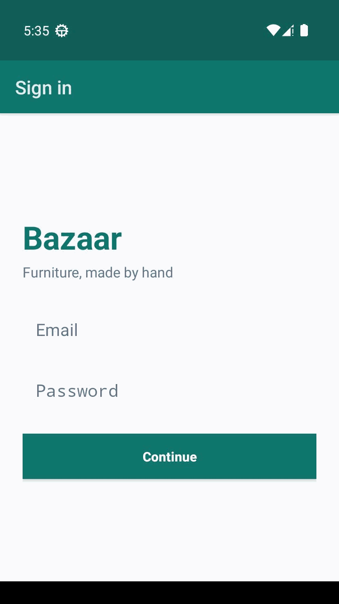
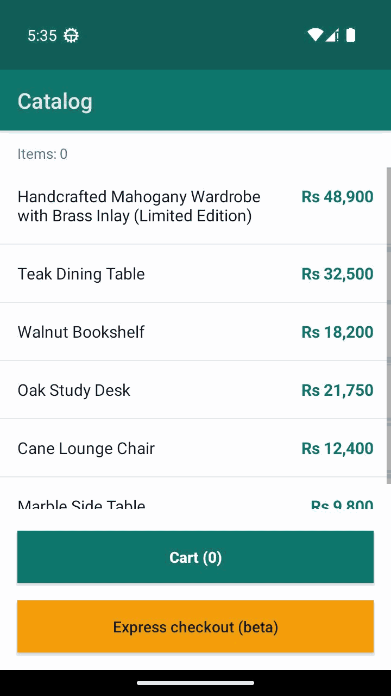
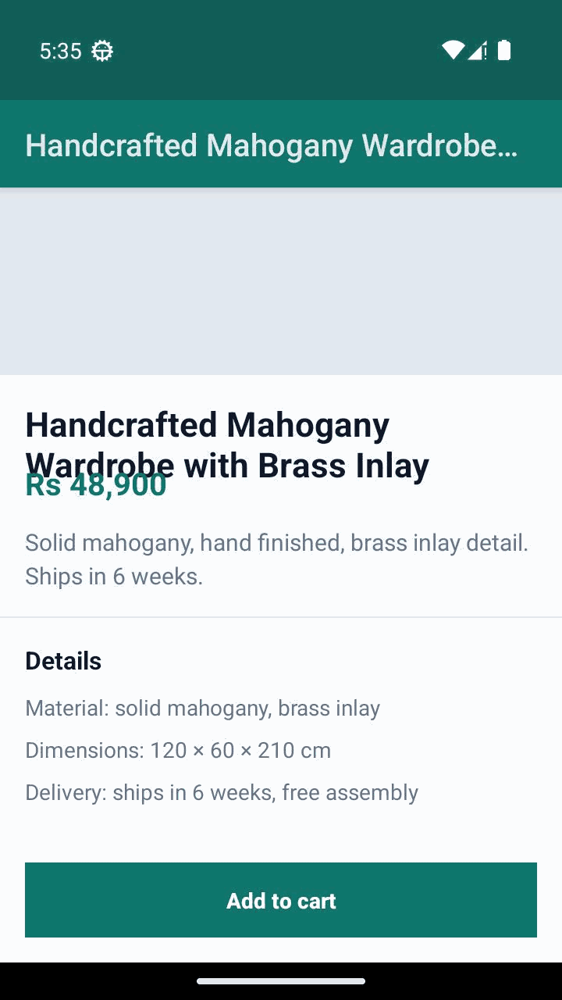
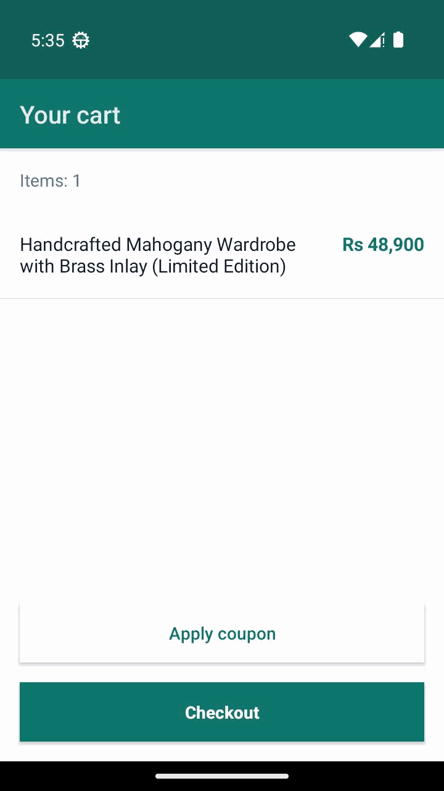
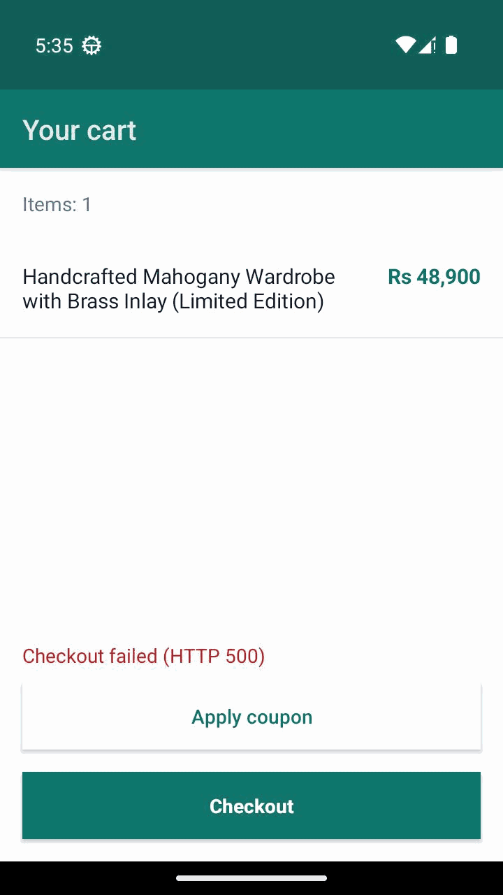

# Bazaar

A small Android shopping app with **five deliberately seeded defects**, used as a
reference fixture and ground-truth benchmark for an automated mobile QA agent.

It exists so that "the agent found a bug" can be checked against a known answer,
and so that "the agent dropped a flaky finding" can be observed rather than
assumed.

> Not a product. Not a demo of good Android engineering. Every defect below is
> intentional and is documented in [`contract.md`](contract.md).

---

## Seeded defects

| ID | Screen | Defect | Expected verdict |
|---|---|---|---|
| **B1** | Product | `NullPointerException` on the second "Add to cart" tap | confirmed 3/3 |
| **B2** | Cart | `HTTP 500` from `POST /api/checkout` | confirmed 3/3 |
| **B3** | Cart | "Apply coupon" has an empty click listener (dead tap) | confirmed 3/3 |
| **B4** | Product | Price text overlaps the product title (stale negative margin) | confirmed 3/3 |
| **B5** | Catalog | "Express checkout" crashes on ~1 tap in 3 | **flaky, dropped** |

B5 is the interesting one: it is the only non-deterministic defect, and a
correct QA agent must **not** report it as a confirmed bug.

---

## Screens

Captured at **720 × 1280** (360 × 640 dp, 320 dpi) — a normal phone viewport, not a
desktop-sized emulator.

| | |
|---|---|
|  |  |
|  |  |
|  | |

---

## Build

Requires JDK 17 and an Android SDK with platform 36.

```bash
# point Gradle at your SDK
echo "sdk.dir=/path/to/Android/Sdk" > local.properties

./gradlew assembleDebug
# -> app/build/outputs/apk/debug/app-debug.apk
```

Verified with Gradle 9.3.1 and AGP 8.12.0. CI does the same on every push
(`.github/workflows/build-apk.yml`); tagged `v*` builds attach the APK to the
GitHub Release so the benchmark can fetch it by URL.

## Run

```bash
pip install fastapi uvicorn
python mock-api/main.py          # binds 0.0.0.0:8100

adb install -r app/build/outputs/apk/debug/app-debug.apk
adb shell am start -n com.bazaar.demo/.LoginActivity
```

The emulator reaches the mock backend at `http://10.0.2.2:8100`. Any
non-empty email and password will pass the login screen.

## Verify the fixture

```bash
pip install uiautomator2 adbutils lxml
python verify/verify_bugs.py
```

Expected output:

```
PASS  B1 crash on 2nd add      NullPointerException: ...Integer.intValue()...
PASS  B4 overlapping text      title=(32, 512, 688, 623) price=(32, 591, 688, 645)
PASS  B2 checkout HTTP 500     net=[... ('500','POST','/api/checkout')] widget='Checkout failed (HTTP 500)'
PASS  B3 dead coupon tap       5c04010d77ff -> 5c04010d77ff
PASS  B5 flaky ~1/3            5/9 (56%)

5/5 checks passed
```

B5 is random, so its count changes per run (4/9, 5/9, …). A run of 9 taps with
**zero** crashes means the fixture is broken, not that the app is clean.

This script is the fixture's own test suite. If it passes, the app is in the
state the benchmark expects.

---

## Design notes

**Classic Views, not Compose.** Every interactive element carries an explicit
`android:id`, so `resource-id` is a first-class selector. Compose would produce a
hierarchy with almost no stable IDs, which would make the fixture easy to pass
and the agent easy to fool.

**Plain HTTP, not TLS.** The mock backend is `http://`, so `mitmproxy` can observe
traffic without a CA certificate, `adb root`, or `adb remount`. Network detection
works on an unrooted emulator image.

**Determinism is a feature.** B1–B4 are deterministic by construction. The only
randomness in the app is B5, and it is random on purpose.

---

## Files

```
app/                     Android app (Java, classic Views)
mock-api/main.py         FastAPI backend; /api/checkout always returns 500
verify/verify_bugs.py    drives the app and asserts every seeded defect
contract.md              the integration contract for the QA agent
benchmark/expected_findings.json   ground truth for scoring
profile.yaml             example target profile
docs/screens/            screenshots at 720x1280
.github/workflows/build-apk.yml    CI build + release asset on v* tags
```

## Limits

- Not published to Play Store; distributed as a debug APK.
- English only, portrait only.
- No real payment, no persistence, no accounts.
- The `release` build type is wired to the debug signing config, so it installs
  without extra setup. Do not publish it.
